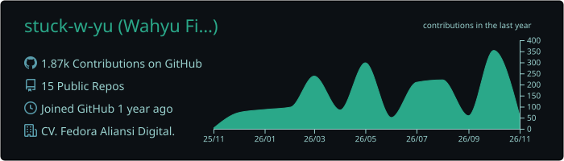
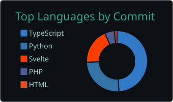

  

  
  
  

Software engineer at **CV. Fedora Aliansi Digital**, Batam. I build web products end to end and keep the network underneath them running — Nuxt/Svelte/Next on the front, Go behind it, MikroTik and WireGuard below that. Currently finishing an Informatics Engineering degree at Universitas Putera Batam.

**Focus**

- **Web products** — Nuxt, Svelte and Next.js frontends; Go or NestJS services; PostgreSQL and MySQL.
- **Infrastructure** — MikroTik routing, WireGuard tunnels, Linux servers, and Discord bots that alert when something breaks.
- **Agent tooling** — MCP servers and automation so AI agents can drive real applications, e.g. [figcraft-mcp](https://github.com/stuck-w-yu/figcraft-mcp).

---

### Stack

| Area | Tools |
| :--- | :--- |
| Languages | Go · TypeScript · JavaScript · Python · SQL |
| Frontend | Nuxt · Svelte · React · Next.js · Tailwind CSS |
| Backend | Go (net/http, chi) · NestJS · Laravel · .NET |
| Data | PostgreSQL · MySQL · Prisma · Supabase |
| Systems | Linux (Arch / CachyOS) · Hyprland · MikroTik RouterOS · WireGuard · Nginx |
| AI / ML | scikit-learn · pandas · Model Context Protocol |

---

### Selected work

| Project | What it does | Stack |
| :--- | :--- | :--- |
| [**figcraft-mcp**](https://github.com/stuck-w-yu/figcraft-mcp) | MCP server that lets AI agents read and edit a live design canvas | TypeScript |
| [**QR-Store**](https://github.com/stuck-w-yu/QR-Store) | Self-order POS — guests scan a table QR code and the order lands in the kitchen | Next.js |
| [**discord-bot-music**](https://github.com/stuck-w-yu/discord-bot-music) | Discord music bot with queues, volume and skip controls | Node.js |
| [**Ahmad-Nadwy**](https://github.com/stuck-w-yu/Ahmad-Nadwy) | Portfolio site built for a client | Next.js |
| Fedora-Mail | Custom mail service for FAD clients — private repo | Svelte · Go |
| Network monitor | MikroTik health checks piped into Discord with on-call alerts — private repo | Python |

---

### GitHub

  
  

---

  Running CachyOS + Hyprland. Ask me about networks, Go, or why the router is always the problem.

